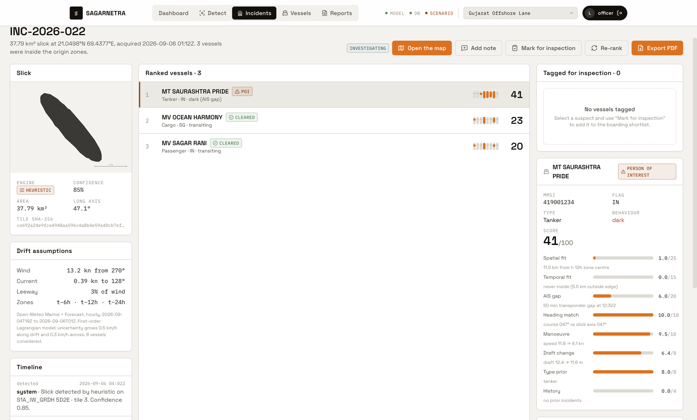
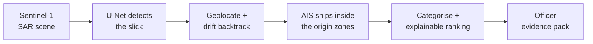
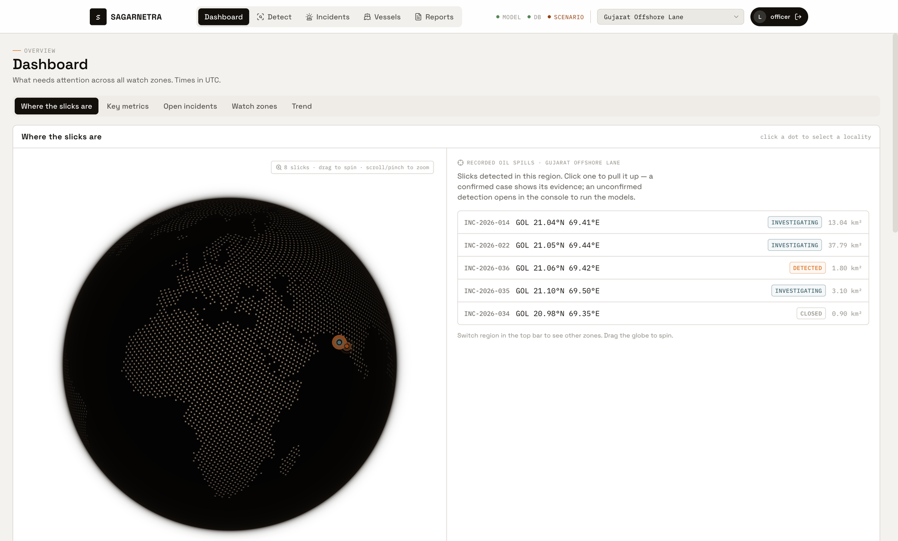
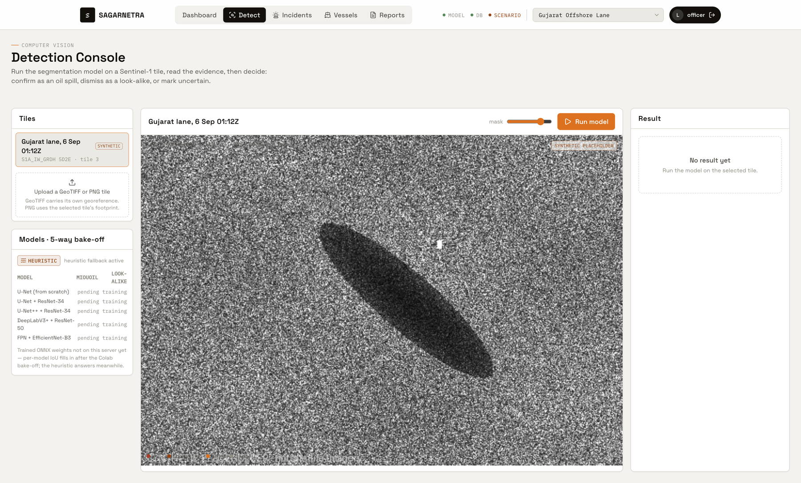
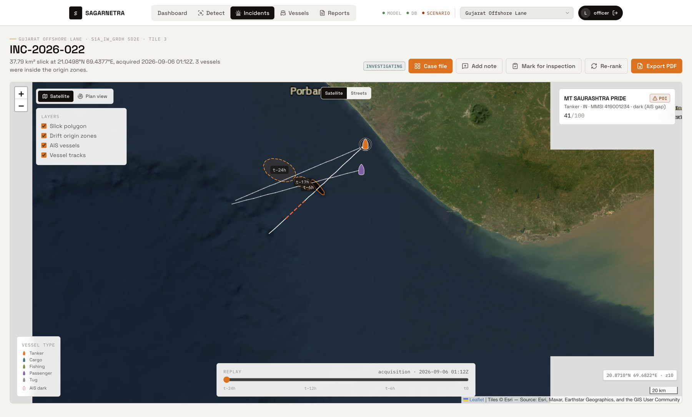
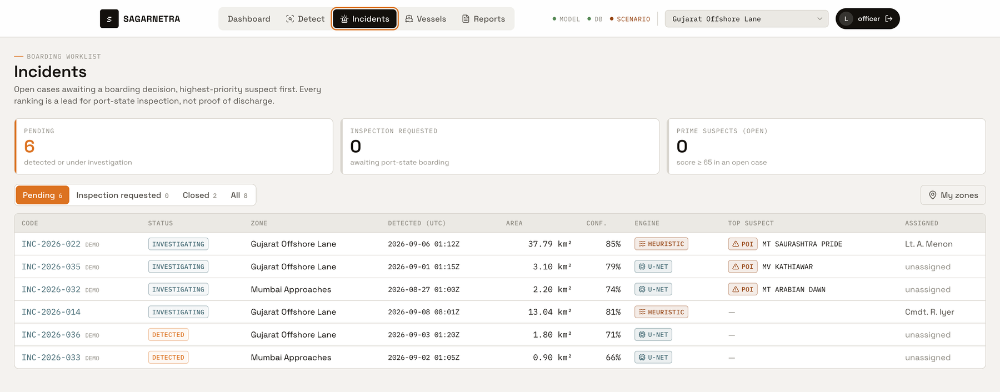
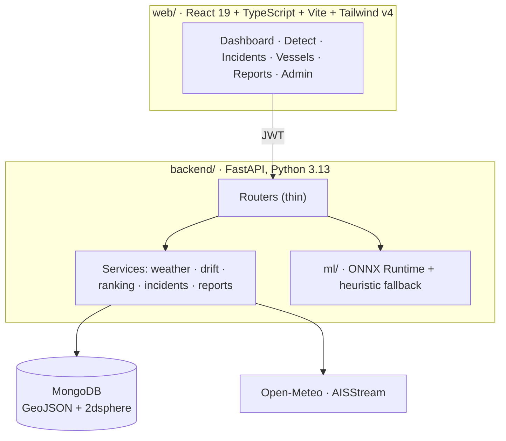

<div align="center">

# SAGARNETRA

**Maritime oil-spill intelligence for the Indian Coast Guard**

Find the slick. Trace it back. Rank the ships that were there.

[](https://github.com/Pjmahendra/SAGARNETRA/actions/workflows/ci.yml)


[](LICENSE)

**Smart India Hackathon 2026 · Problem Statement SIH26143 · Team SUPERHEROES · SRM University–AP**

</div>



## The problem

When an oil slick appears off the Indian coast, the Coast Guard has to work out *which ship did it*. Today that means staring at satellite images, guessing where the oil came from, and manually checking ship movements. It is slow, and the oil keeps drifting while people work.

## What SAGARNETRA does

SAGARNETRA turns that into one pipeline an officer can run end to end in a single tool:



1. **Detect.** A segmentation model finds dark oil-like patches in radar imagery, and an officer confirms each one or marks it as a look-alike (algae, low wind, rain cells).
2. **Trace.** Wind and ocean-current data push the slick *backwards in time* to produce origin zones at 6, 12 and 24 hours earlier.
3. **Match.** Every vessel that was inside those zones, from live and recorded AIS, becomes a candidate.
4. **Rank.** Each candidate gets one 0–100 score built from eight named features. Nothing is a black box: the officer sees exactly why a ship scored what it did.
5. **Report.** The officer freezes an immutable, hash-chained evidence pack for the case file.

> **This is inspection targeting, not culprit attribution.** The output is a ranked shortlist of ships worth boarding or querying. It is never a verdict.

### The ranking, in plain terms

| Feature | Max points | What it asks |
|---|---:|---|
| Spatial fit | 25 | Was the ship inside the backtracked origin zone? |
| AIS gap | 20 | Did its transponder go dark around the time? |
| Temporal fit | 15 | Was it there at the right time? |
| Heading match | 10 | Was it sailing along the slick's long axis? |
| Manoeuvre | 10 | Did it change speed or course suspiciously? |
| Draft change | 8 | Did its reported loading draft change? |
| Vessel-type prior | 8 | How likely is this type of ship to discharge oil? |
| History | 4 | Has it ranked high in earlier incidents? |

Tiers: **Prime**, **Person of interest**, **Cleared**. Weights live in one place, [`backend/app/services/ranking.py`](backend/app/services/ranking.py).

## Screenshots

| Dashboard | Detection console |
|---|---|
|  |  |
| **Investigation map** | **Incidents and reports** |
|  |  |

## Features

- **Detection service.** Upload or pick a tile; the ONNX U-Net runs if weights exist, otherwise a dark-spot heuristic runs. The API always reports which engine produced the result.
- **Drift backtracking.** Open-Meteo wind and current data feed a first-order Lagrangian model with uncertainty that grows with time.
- **Explainable ranking.** Eight features, fixed weights, a per-feature breakdown for every vessel.
- **Evidence packs.** Revisioned, immutable report snapshots with chain-of-custody hashes. Export to PDF from the print view.
- **Role-based access.** Two roles, `admin` and `officer`. No public signup. Officers only see the sectors they are assigned.
- **Sector grid.** 16 Indian sectors across the five Coast Guard regions, each with traffic sized to its real busyness.
- **Live AIS recorder.** A collector for [AISStream](https://aisstream.io) feeds two sectors with real vessel tracks.
- **Audit log.** Sensitive actions are recorded.

## Be honest about the data

Judges and officers should always know what is real. SAGARNETRA labels it in the UI and in every evidence pack.

| Input | Status |
|---|---|
| Wind and current | **Real**, from Open-Meteo (with a labelled climatological fallback if offline) |
| AIS, Chennai–Ennore and Dover Strait | **Real**, recorded live |
| AIS, the other 14 Indian sectors | **Scenario**, generated and clearly marked `source: scenario` |
| Sample SAR tiles in `ml/samples/` | **Synthetic placeholders**, watermarked and flagged `synthetic: true` |
| Trained model weights | **Not yet shipped.** The 5-model training pipeline is built and waits on the Krestenitis dataset; until then the heuristic runs |

The worked Dover Strait case is ranked against about 120 genuine vessels, 7 with real MMSIs and tracks.

## Architecture



More detail in [docs/ARCHITECTURE.md](docs/ARCHITECTURE.md).

## Tech stack

| Layer | Technology |
|---|---|
| Frontend | React 19, TypeScript, Vite, Tailwind CSS v4, TanStack Query, Zustand, Leaflet, cobe globe, Motion |
| Backend | FastAPI, Motor (async MongoDB), PyJWT, bcrypt, slowapi, pydantic-settings |
| ML | PyTorch (training on Colab), ONNX export, ONNX Runtime for serving |
| Data | MongoDB with GeoJSON and 2dsphere indexes |
| Quality | pytest on in-memory Mongo, ruff, oxlint, GitHub Actions CI |
| Deployment targets | Vercel (web), Render (backend, Docker), MongoDB Atlas |

## Quick start

You need Node 22+, Python 3.13 and Docker (or a local MongoDB).

```bash
# 1. database
docker compose up -d

# 2. backend
cd backend
python3.13 -m venv .venv && source .venv/bin/activate
pip install -r requirements.txt -r requirements-dev.txt
cp .env.example .env            # then set JWT_SECRET to a long random string
python -m scripts.seed_db       # creates demo users and scenario data
uvicorn app.main:app --reload --port 8000

# 3. frontend (new terminal)
cd web
npm install
echo "VITE_API_BASE=http://localhost:8000" > .env.local
npm run dev
```

| URL | What |
|---|---|
| http://localhost:5173 | The app |
| http://localhost:8000/docs | Interactive API docs |

**Just want to see the UI?** Skip steps 1 and 2, leave `VITE_API_BASE` empty, and the frontend runs on bundled mock data.

### Demo accounts (local development only)

Created by the seed script. Never use these outside your own machine.

| Role | Email | Password | Sees |
|---|---|---|---|
| Admin | `admin@sagarnetra.in` | `Admin@123` | Everything, plus user, zone and audit admin |
| Officer | `officer@sagarnetra.in` | `Officer@123` | The 15 scenario sectors |
| Officer | `officer.ais@sagarnetra.in` | `Officer@123` | The 2 live-AIS sectors |

## Testing

```bash
cd backend && pytest -q && ruff check .     # 37 tests, no database server needed
cd web && npm run lint && npm run build
```

CI runs both on every pull request.

## Repository layout

```
web/         Frontend (Vercel)
backend/     API, services, seed and collector scripts, tests (Render)
ml/          U-Net models, training harness, ONNX export and inference
notebooks/   Colab training notebook
scripts/     Asset helpers
docs/        Architecture, decisions, research, report, submission deck
```

## Documentation

| Doc | Contents |
|---|---|
| [Architecture](docs/ARCHITECTURE.md) | Components, data flow, data model |
| [Project report](docs/PROJECT_REPORT.md) | Verified engineering report, provenance, worked case |
| [Decision log](docs/DECISIONS.md) | Dated record of every locked decision |
| [Research dossier](docs/research.md) | Prior art (SkyTruth Cerulean), datasets, standards |
| [Build plan](docs/build-plan.html) | Original plan: roles, modules, API, demo script |
| [SIH deck](docs/submission/SAGARNETRA_SIH26143_Deck_6Page.pptx) | The 6-slide submission deck |

## Roadmap

- [ ] Run the 5-model training bake-off once the Krestenitis dataset is available, ship the winning ONNX model
- [ ] Real Sentinel-1 tiles through Copernicus Data Space
- [ ] Admin create-user form
- [ ] Interactive 3D map (Cesium)

## Prior art

[SkyTruth Cerulean](https://cerulean.skytruth.org) detects slicks and links them to vessels. SAGARNETRA's contribution is the workflow around it: inspection-targeting framing, look-alike discrimination for Indian waters, drift backtracking, one explainable fused score, and a Coast Guard evidence-pack process.

## Contributing

See [CONTRIBUTING.md](CONTRIBUTING.md). Security issues: [SECURITY.md](SECURITY.md).

## Team

**Team SUPERHEROES**, SRM University–AP.

[@Pjmahendra](https://github.com/Pjmahendra) · [@BPunith-tech](https://github.com/BPunith-tech)

## License

[MIT](LICENSE)
