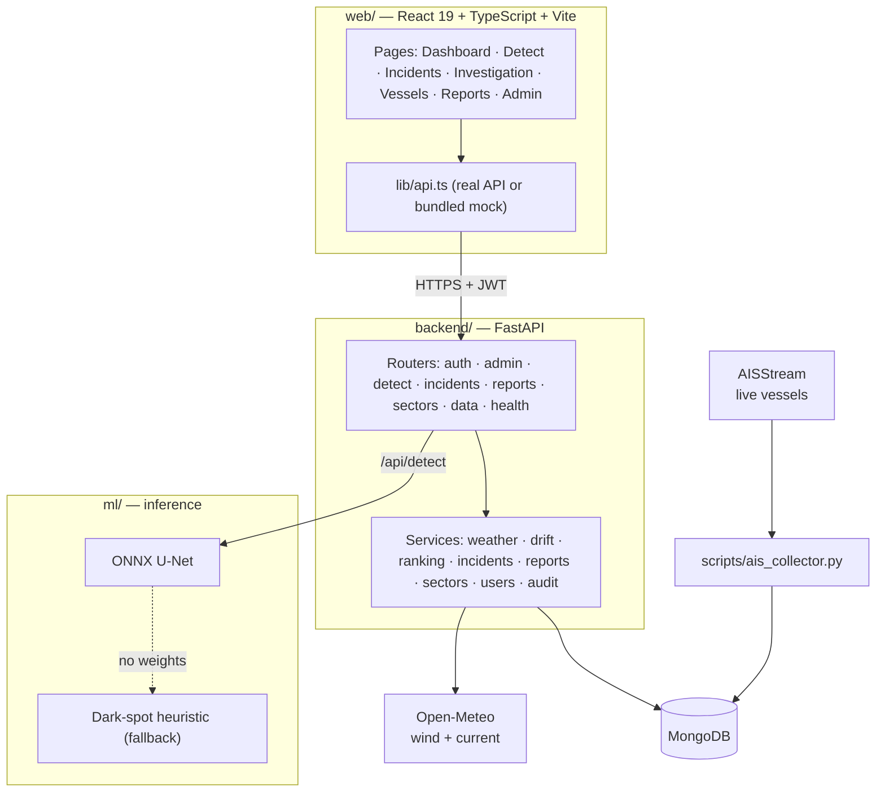
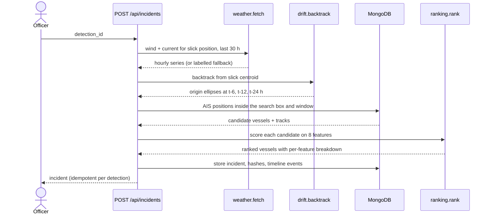

# Architecture

SAGARNETRA is three deployable pieces and one database. This page is the map; the [project report](PROJECT_REPORT.md) has the verified detail and [DECISIONS.md](DECISIONS.md) explains why each choice was made.

## Components

## The create-incident pipeline

What happens when an officer opens an investigation from a confirmed detection:

Creating an incident twice from the same detection returns the same incident.

## Data model

| Collection | Holds |
|---|---|
| `users` | Email, bcrypt hash, role (`admin` or `officer`), assigned sector ids |
| `watch_zones` | Sector polygons (GeoJSON, 2dsphere index) |
| `detections` | Slick polygon, area, centroid, heading, engine used, officer verification |
| `incidents` | Case record: origin zones, drift inputs, ranking, hashes, timeline events |
| `reports` | Immutable, revisioned evidence-pack snapshots |
| `vessels` | Static vessel details keyed by MMSI |
| `ais_positions` | Position reports, `source` is `live` or `scenario`. Live rows expire after 7 days |
| `samples` | Bundled sample tiles (synthetic, flagged as such) |
| `audit` | Who did what, and when |
| `counters` | Incident code sequence (`INC-YYYY-NNN`) |

## API surface

All routes are under `/api` and need a bearer token except `login` and `health`. Full interactive docs are served at `/docs` when the backend runs.

| Group | Routes |
|---|---|
| Auth | `POST /auth/login`, `GET /auth/me`, `POST /auth/logout`, `POST /auth/change-password` |
| Detect | `GET /detect/samples`, `GET /detect/samples/{id}/image`, `GET /detect/model`, `POST /detect`, `POST /detect/{id}/verify` |
| Incidents | `GET/POST /incidents`, `GET /incidents/{id}`, `GET /incidents/{id}/tracks`, `POST /incidents/{id}/events`, `POST /incidents/{id}/rerank` |
| Reports | `GET/POST /reports`, `GET /reports/{id}` |
| Sectors | `GET /sectors`, `GET /sectors/{id}` |
| Data | `GET /overview`, `GET /vessels/live`, `GET /vessels/{mmsi}` |
| Admin | `GET/POST /admin/users`, `PATCH /admin/users/{id}`, `POST /admin/users/{id}/reset-password`, `GET/POST /admin/zones`, `GET /admin/audit` |
| Health | `GET /health` |

## Access control

- Two roles. `admin` provisions users and zones and reads the audit log; `officer` runs investigations. Admin can do everything an officer can.
- No public signup. Admins create accounts.
- Every read is scoped to the sectors assigned to the caller, so one officer cannot see another officer's water.

## Design rules that shape the code

- **Routers are thin, services hold the logic.** Services are plain functions over a database handle, which is why the tests run on in-memory Mongo.
- **Weights live in one place.** `ranking.WEIGHTS` is the only definition of the score.
- **Provenance travels with the data.** Every incident records where its weather and AIS inputs came from (`weather_source`, `ais_source`), and the UI and evidence pack show it.
- **A fallback always exists.** No weights means the heuristic detector; no weather service means a labelled climatological fallback. The system degrades visibly, never silently.
- **Serve with ONNX Runtime, not PyTorch,** to keep the backend's memory small enough for a free-tier host.
